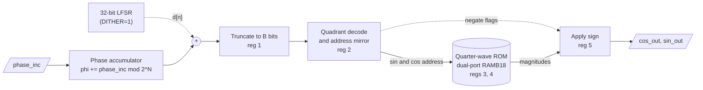

# nco: Numerically Controlled Oscillator

Generates a quadrature tone (`cos_out`, `sin_out`) at a frequency set at run time, one sample per enabled clock. It uses a phase accumulator and a quarter-wave sine ROM in a single block RAM. Optional LFSR phase dither trades phase-truncation spurs for a slightly higher, white noise floor.

| | |
| --- | --- |
| RTL | [`nco.sv`](nco.sv), using [`lfsr.sv`](../common/lfsr.sv) for dither |
| Bit-exact model | [`dsplib/nco.py`](../../python/src/dsplib/nco.py) |
| Tests | [`test_nco.py`](test_nco.py) (cocotb vs the model), [`test_nco_model.py`](../../python/tests/test_nco_model.py) (model vs ideal math) |
| Synthesis | [`synth.toml`](synth.toml): results in [Synthesis](#synthesis) |

## Algorithm

Symbols: $`N`$ = `PHASE_W` (accumulator bits), $`M`$ = `ADDR_W` (ROM address bits), $`B = M + 2`$ (phase bits after truncation), $`W`$ = `OUT_W` (output bits), and $`f_s`$ is the rate of `en`, which equals $`f_{clk}`$ when `en` is held high.

**Phase accumulator.** Each enabled sample adds the tuning word $`\Delta\phi`$ (`phase_inc`) modulo $`2^N`$:

```math
\phi[n+1] = \left(\phi[n] + \Delta\phi\right) \bmod 2^N,
\qquad
f_{out} = \frac{\Delta\phi}{2^N}\, f_s,
\qquad
\Delta f_{min} = \frac{f_s}{2^N}
```

Read as a signed $`N`$-bit number, $`\Delta\phi`$ gives negative frequencies too, so the tuning range is $`[-f_s/2,\ f_s/2)`$. With $`N = 32`$ at 61.44 MSPS the resolution is about 14 mHz. Sample $`n`$ uses the phase *before* its own increment. A new $`\Delta\phi`$ therefore takes effect from the next sample, and the phase stays continuous across the change.

**Phase truncation and dither.** Only the top $`B`$ bits address the table. With `DITHER=1`, a pseudo-random $`d[n] \in [0, 2^{N-B})`$ is added below the truncation point first. It comes from the low bits of a 32-bit LFSR.

```math
\theta[n] = \left\lfloor \frac{(\phi[n] + d[n]) \bmod 2^N}{2^{N-B}} \right\rfloor \in [0,\ 2^B)
```

**Quarter-wave ROM.** The ROM stores one quadrant of a sine, sampled at half-LSB offsets with amplitude $`A = 2^{W-1} - 1`$:

```math
R[k] = \mathrm{round}\!\left(A \sin\!\left(\frac{\pi}{2} \cdot \frac{k + \tfrac{1}{2}}{2^{M}}\right)\right),
\qquad k = 0, \dots, 2^M - 1
```

Sampling at $`k + \tfrac12`$ means the quadrant symmetry $`\sin(\tfrac{\pi}{2} - x) = \cos x`$ maps entry $`k`$ to entry $`2^M - 1 - k = \bar{k}`$. That is the bitwise inverse of the address, so mirroring needs no adder. No entry is 0 either, so negation is symmetric. The table holds $`(W-1)`$-bit magnitudes, and the quadrant supplies the sign.

**Quadrant mapping.** $`q_1 q_0`$ are the top two bits of $`\theta`$ and $`k`$ is its low $`M`$ bits:

| $`q_1 q_0`$ | Phase | sin address | cos address | sin sign | cos sign |
| :---: | :---: | :---: | :---: | :---: | :---: |
| 00 | $`[0, \pi/2)`$ | $`k`$ | $`\bar{k}`$ | + | + |
| 01 | $`[\pi/2, \pi)`$ | $`\bar{k}`$ | $`k`$ | + | − |
| 10 | $`[\pi, 3\pi/2)`$ | $`k`$ | $`\bar{k}`$ | − | − |
| 11 | $`[3\pi/2, 2\pi)`$ | $`\bar{k}`$ | $`k`$ | − | + |

So sin is negated when $`q_1 = 1`$ and cos when $`q_1 \oplus q_0 = 1`$, and each output is within half an LSB of

```math
\mathtt{cos\_out}[n] \approx A \cos\!\left(\frac{2\pi\,(\theta[n] + \tfrac12)}{2^B}\right),
\qquad
\mathtt{sin\_out}[n] \approx A \sin\!\left(\frac{2\pi\,(\theta[n] + \tfrac12)}{2^B}\right)
```

That is, a fixed phase offset of $`\pi / 2^B`$ rad plus rounding.

**Spurs.** Truncating the phase to $`B`$ bits gives a periodic phase error. Its spurs limit the spurious-free dynamic range to roughly

```math
\mathrm{SFDR} \approx 6.02\, B \ \text{dBc}
```

That is about 72 dBc for the default $`B = 12`$, well above the floor set by $`W = 16`$-bit amplitude quantization, so phase truncation is the limit. Dither turns the periodic error into noise: the spurs drop well below that bound, at the cost of a raised but white noise floor.

## Dataflow

`en` flows down a 5-register path to `valid`, matching the five data registers below (`LATENCY = 5`).



## Interface

| Parameter | Default | Meaning |
| --- | ---: | --- |
| `PHASE_W` | 32 | Phase accumulator width $`N`$ |
| `ADDR_W` | 10 | Quarter-wave ROM address width $`M`$; phase resolution is $`B = M + 2`$ bits |
| `OUT_W` | 16 | Signed output width $`W`$ |
| `DITHER` | 0 | Add LFSR phase dither; needs $`1 \le N - B \le 32`$ |
| `LFSR_SEED` | 1 | LFSR seed (nonzero) |

| Port | Dir | Width | Meaning |
| --- | :---: | ---: | --- |
| `clk` | in | 1 | Clock |
| `rst` | in | 1 | Synchronous, active-high. Clears the accumulator and `valid` pipeline and reloads the LFSR seed |
| `en` | in | 1 | Produce one sample; may be gapped arbitrarily |
| `phase_inc` | in | $`N`$ | Tuning word $`\Delta\phi`$, sampled when `en` is high |
| `valid` | out | 1 | High exactly 5 cycles after each `en` |
| `cos_out`, `sin_out` | out | $`W`$ | Signed quadrature outputs, meaningful when `valid` is high |

Throughput is one sample per clock. Only the accumulator and `valid` are reset; the data pipeline is not.

## Verification

- [`test_nco.py`](test_nco.py) runs on Verilator for `DITHER=0` and `DITHER=1`:
  - `nco_bit_exact_and_latency` uses random gapped `en` (75% duty) and tuning words 0, 1, $`2^{31}`$ (Nyquist), $`2^{32}-1`$, a spur-prone word and random words. Every output must match `dsplib.nco.nco` bit for bit and arrive exactly 5 cycles after its `en`.
  - `nco_sfdr` runs a 16384-sample continuous tone at `0x01234567`. Its low bits are nonzero, so truncation spurs are at their worst. Output must be bit-exact, and SFDR must be at least $`6.02B - 1`$ dBc undithered, or at least $`6.02B + 12`$ dBc dithered.
- [`test_nco_model.py`](../../python/tests/test_nco_model.py) steps the model through every truncated phase and checks each output is within 0.5 LSB of the ideal $`A\cos`$ and $`A\sin`$ above.

```
just test-hdl nco             # both configs
PLOT=1 just test-hdl nco      # ...and plot the SFDR captures
just synth nco                # Vivado: refresh the section below
```

## Synthesis

Intended mapping:
- The $`2^{10} \times 15`$-bit ROM is one RAMB18E1 in true dual-port mode, with port A reading sin and port B reading cos. The second read register is absorbed into the BRAM output register (`DOA_REG`/`DOB_REG` = 1).
- There is no multiplier, so no DSP48.
- The accumulator, the dither adder and the output negation are CARRY4 chains, and the 3-deep negate-flag delay becomes SRL16Es.
- The worst path is the final conditional negate: `neg` flag, through the carry chain, into `cos_out`.

[`synth.toml`](synth.toml) asserts the RAMB18E1/DSP48E1 counts exactly and puts ceilings on LUTs and FFs.

<!-- synth:begin hash=837cfee528b6 -->
<!-- Generated by `just synth nco`; edits between these markers are overwritten. -->

Vivado 2025.1 · `xc7z010clg225-1` · out-of-context synth + place & route · target 250 MHz (`clk` 4.0 ns) · source hash `837cfee528b6`

| Config | Parameters | Slice LUTs | LUTRAM/SRL | FFs | CARRY4 | BRAM tiles | DSPs | WNS (ns) | Fmax (MHz) |
| --- | --- | ---: | ---: | ---: | ---: | ---: | ---: | ---: | ---: |
| `dither0` | `PHASE_W=32 ADDR_W=10 OUT_W=16 DITHER=0` | 75 (0.43%) | 2 | 113 (0.32%) | 16 | 0.5 (0.83%) | 0 (0.00%) | +0.680 | 301 |
| `dither1` | `PHASE_W=32 ADDR_W=10 OUT_W=16 DITHER=1` | 97 (0.55%) | 2 | 145 (0.41%) | 24 | 0.5 (0.83%) | 0 (0.00%) | +0.527 | 288 |

Hard blocks and worst setup path:

- `dither0`: 1× RAMB18E1 `RAM_MODE=TDP READ_WIDTH_A=18 READ_WIDTH_B=18 DOA_REG=1 DOB_REG=1 INIT=nonzero`; path `neg_reg[2][0]/C` → `cos_out_reg[15]/D`, 5 logic levels
- `dither1`: 1× RAMB18E1 `RAM_MODE=TDP READ_WIDTH_A=18 READ_WIDTH_B=18 DOA_REG=1 DOB_REG=1 INIT=nonzero`; path `neg_reg[2][0]/C` → `cos_out_reg[15]/D`, 4 logic levels

Fmax ≈ 1/(T − WNS) is a lower bound: place & route stops improving once the target is met. Only reg-to-reg paths are timed; ports have no I/O constraints.
<!-- synth:end -->
